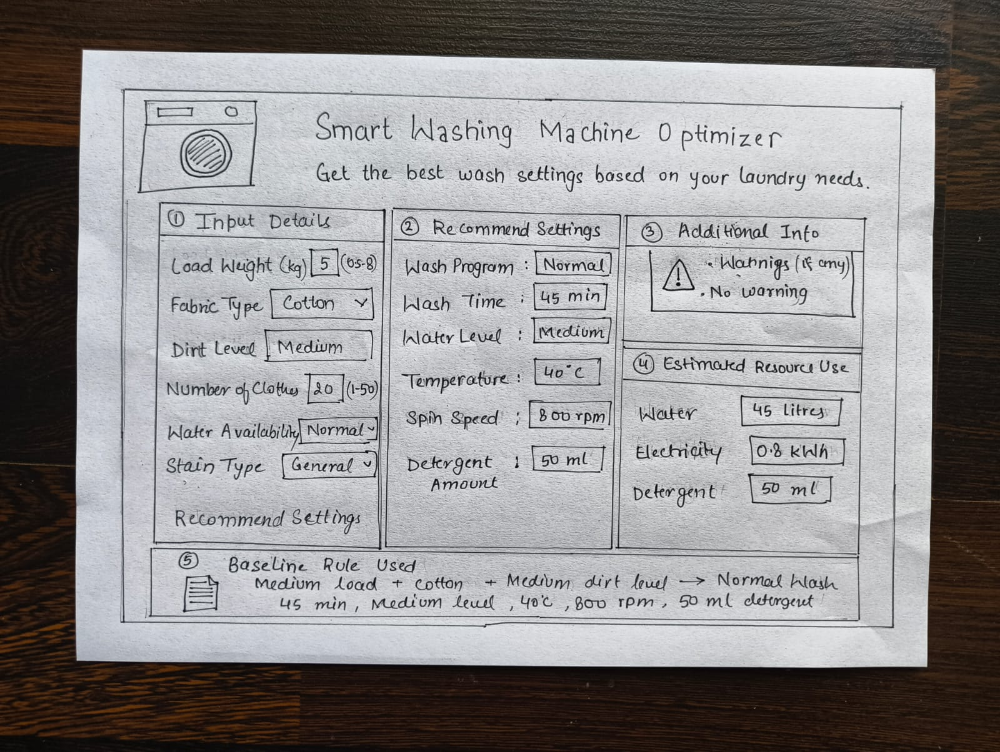

# Step 1 Project Contract

## Team and Responsibilities

**Team Name:** Smart Spin

1. Aditya Tripathi - Repository and project setup
2. Ajay Gangwar - Data and input fields
3. Nitin Kumar - Baseline rules
4. Priyanshu Rajput - Testing and UI

## One-Sentence Problem

Given dirt, load, fabric, and water availability, recommend wash time, water, detergent, and spin speed.

## User of the Product

A washing-machine user who needs safe settings without wasting water or detergent.

## Inputs and Units

| Input | Meaning | Unit / Type |
|---|---|---|
| scenario_id | Unique wash-case name | Text |
| dirt_score | How dirty the clothes are | 0 to 10 |
| load_kg | Weight of clothes | kg |
| fabric_type | Main fabric type | Category |
| water_availability_pct | Water available | 0 to 100% |

## Outputs and Units

- `wash_time_min` - Wash time in minutes
- `water_litre` - Water used in litres
- `detergent_ml` - Detergent amount in millilitres
- `spin_rpm` - Spin speed in RPM

## Baseline Method

The baseline will use fixed washing presets for different fabric types.

The baseline will include presets for:

1. Delicate
2. Cotton
3. Synthetic
4. Heavy

If the load is above the washing machine capacity, the system will show an error instead of giving washing settings.


### Inputs the baseline does not use

The baseline picks one fixed preset from `fabric_type` only. It deliberately ignores `dirt_score`, `load_kg` and `water_availability_pct`, because a fixed-programme machine does not measure them. It still checks that all four inputs are valid. This makes it a fair, simple reference: the later fuzzy controller is the method that adapts to dirt, load and water, and the comparison shows what that adaptation gains or costs.

### Reproducing the validation checks

Run from the project root:

```text
python src/validate_data.py                         # checks data/sample_input.csv -> PASS
python src/validate_data.py data/invalid_input.csv  # checks the invalid row -> FAIL, lists every error, exit code 1
```

`data/invalid_input.csv` holds two rows that must be rejected: INVALID-001 (dirt 11, load 9 kg, fabric "unknown", water 110%) and SC02-005 (8.5 kg, over the 8 kg capacity), which is mandatory test case 5. They are kept out of `data/sample_input.csv`, which has 20 valid rows. The saved screenshots are `results/step1/Pass.png` and `results/step1/Fail.png`.

## Soft Computing Method for M1

A Fuzzy Logic washing controller will be developed and compared with fixed washing presets.

## Advanced Method for M2

A Genetic Algorithm will be used to balance washing quality with water, detergent, and energy usage.

## Dataset / Scenario Sources

The starter data will be created using the ranges and assumptions defined by the team.

Sources and assumptions will be added here as the project develops.

## Five Mandatory Test Cases

1. Light dirt and half-load
2. Heavy dirt and full load
3. Delicate fabric
4. Low-water situation
5. Over-capacity load - validation should reject it

## Product V1 Screen Sketch

The screen will contain:

- Input fields for dirt score, load, fabric type, and water availability
- A Recommend button
- Washing recommendations
- Validation/error messages
- Baseline result
- Future Soft Computing result

The screen sketch is saved at `docs/Sketch.jpeg`:



## Risks and Assumptions

- Some initial data may be simulated.
- Temporary thresholds will be clearly marked.
- Washing machine capacity and input ranges will be finalized by the team.
- Sources and assumptions will be documented before the final version.

## Step 1 Completion Evidence

Step 1 evidence in this repository:

- Repository and collaborator setup
- Sample data
- Validation results
- Five test cases
- Baseline rules
- Product V1 screen sketch
- Git commits from all team members
