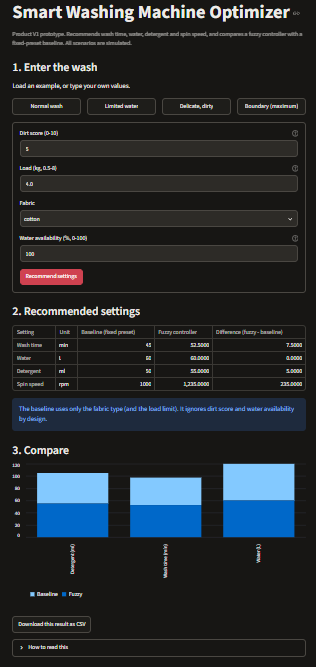
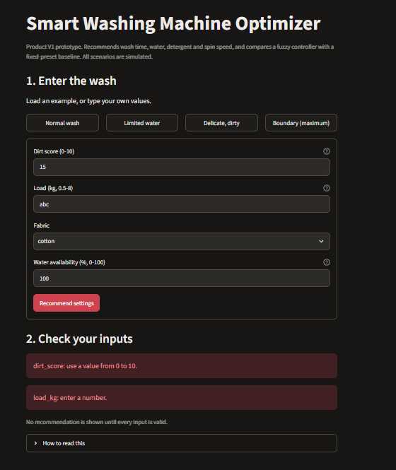
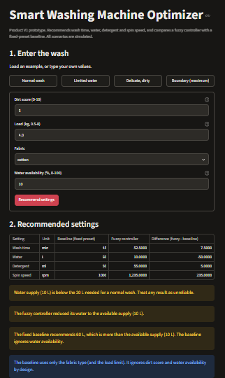

# Step 5: Product V1 (working interface)

## 1. What was built
A Streamlit app where a user enters a wash and gets recommended wash time, water, detergent and spin speed from two methods on the **same inputs**: the fixed-preset baseline and the fuzzy controller. Nothing is trained or tuned when the button is pressed. The app only calls the saved Step 3/4 code.

| Item | Value |
|---|---|
| Interface type | Streamlit web app, run locally |
| Entry-point file | `app/app.py` |
| Logic (testable without Streamlit) | `src/product_predict.py` |
| Saved methods used | `src/baseline.py` (fixed presets) and `src/fuzzy_controller.py` (fuzzy controller) |
| Dependencies | `requirements.txt` (pandas, numpy, matplotlib, jupyter, streamlit) |
| Branch | `step-5-product-v1` |
| Demo URL | None. This is a local demonstration. |

## 2. How to run it
```text
pip install -r requirements.txt
python -m streamlit run app/app.py
```
Open the local address printed in the terminal (normally http://localhost:8501).

## 3. What the user sees
1. **Enter the wash:** dirt score (0-10), load in kg (0.5-8), fabric (delicate, cotton, synthetic, heavy) and water availability in % (0-100). Four example buttons fill the form: Normal wash, Limited water, Delicate dirty, Boundary (maximum).
2. **Recommended settings:** a table of wash time (min), water (L), detergent (ml) and spin (rpm), with the baseline, the fuzzy controller and the difference.
3. **Messages:** a warning when the fuzzy water was reduced to the supply, when the baseline recommends more water than exists, and when the supply is below the 20 L needed for a normal wash. A note says the baseline ignores dirt and water availability by design.
4. **Compare:** a bar chart of time, water and detergent, and a button to download the result as CSV.
5. **How to read this:** an expander explaining each method, the difference column and the limits.

## 4. Input validation
Every input is checked before anything runs. The app lists every problem at once and shows no recommendation until all inputs are valid.

| Input problem | Message shown |
|---|---|
| Out of range (for example dirt 15) | `dirt_score: use a value from 0 to 10.` |
| Text in a number field | `dirt_score: enter a number.` |
| Blank field | `load_kg: enter a value.` |
| Unknown fabric | `fabric_type: choose one of: delicate, cotton, synthetic, heavy.` |

If a saved controller file is missing, the app shows `The saved controller file src/fuzzy_controller.py is missing. Restore the Step 3/4 files from the repository and restart the app.` and hides the form.

## 5. Observed results (from the tests in this branch)
| Example | Inputs (dirt, kg, fabric, water %) | Baseline (min / L / ml / rpm) | Fuzzy (min / L / ml / rpm) |
|---|---|---|---|
| Normal wash | 5, 4.0, cotton, 100 | 45 / 60 / 50 / 1000 | 52.5 / 60.0 / 55.0 / 1235 |
| Limited water | 5, 4.0, cotton, 10 | 45 / 60 / 50 / 1000 | 52.5 / **10.0** / 55.0 / 1235 |
| Delicate, dirty | 8, 2.0, delicate, 80 | 30 / 40 / 30 / 600 | 59.24 / 56.88 / 61.32 / 565 |
| Boundary (maximum) | 10, 8, heavy, 100 | 60 / 75 / 60 / 1200 | 77.67 / 86.83 / 85.17 / 1235 |

What this shows:
- With limited water (10 L available) the baseline still recommends 60 L, which does not exist. The fuzzy controller reduces its water to 10 L, and the app warns that this is below the 20 L needed for a normal wash.
- With plenty of water the fuzzy controller uses more time and detergent than the baseline for these examples.
- For a dirty delicate load the fuzzy controller uses almost twice the wash time of the baseline, but keeps a gentle 565 rpm spin.
- **No resource saving is claimed.** The full 10,000-scenario comparison is in `docs/STEP-4.md`.

## 6. Test evidence
The full test report is `docs/STEP-6.md`. The checks for this step are:

| Check | How | Result |
|---|---|---|
| Normal, boundary and invalid input | `python -m unittest -v tests.test_product_predict` | 15 tests, OK |
| Screen result equals code result | `tests/test_product_predict.py` and `tests/test_app_ui.py` | OK |
| Interface behaviour (inputs, messages, no result on error) | `python -m unittest -v tests.test_app_ui` | 9 tests, OK |
| Missing controller file, then recovery | `tests/test_app_ui.py` (disposable copy) | OK |

Logs are saved in `results/step6/`.

## 7. Screenshots
<!-- Capture these three from the running app and save them in docs/screenshots/ before submitting. -->
| What it shows | File |
|---|---|
| Normal wash result table and chart | `docs/screenshots/step5_normal.png` |
| Input error messages | `docs/screenshots/step5_errors.png` |
| Limited-water warnings | `docs/screenshots/step5_limited_water.png` |





## 8. Earlier feedback addressed
| Earlier feedback | How Product V1 handles it |
|---|---|
| Handle limited water (Steps 3 and 4) | The fuzzy water is capped at the supply and the app says so. The baseline's over-supply is also flagged. |
| Keep the measured result clear: no resource savings shown (Steps 3 and 4) | The app never claims savings. It shows both methods side by side, and the "How to read this" section repeats this. |
| Explain the inputs the baseline ignores (Step 1) | A note on every result says the baseline ignores dirt score and water availability. |
| The energy index is not electricity (Step 4) | The app shows no energy figure. |

## 9. Known limits
- All data, the 100 L supply scale, the 20 L minimum and the baseline presets are simulated team assumptions, not measured values.
- At 0% water availability the fuzzy controller recommends 0 L and the app warns that the result is unreliable. It does not say "cannot wash".
- The fuzzy water rules still ask for more water than the supply in many scenarios (see `docs/STEP-4.md`).
- Tested with the headless Streamlit test tool. The team should also run the app in a browser (see `docs/STEP-6.md`).
- Local demonstration only. No hosted version.

## 10. Member contributions (fill in with what each person actually did)
| Member | Contribution |
|---|---|
| Aditya Tripathi | Committed the app interface (app/app.py), ran the app in the browser, and took and uploaded the screenshots. |
| Ajay Gangwar | Committed the Step 5 report (docs/STEP-5.md). |
| Nitin Kumar | Committed the tests (tests/test_product_predict.py, tests/test_app_ui.py). |
| Priyanshu Rajput | Committed the product logic and scripts (src/product_predict.py, src/check_product_prediction.py). |
